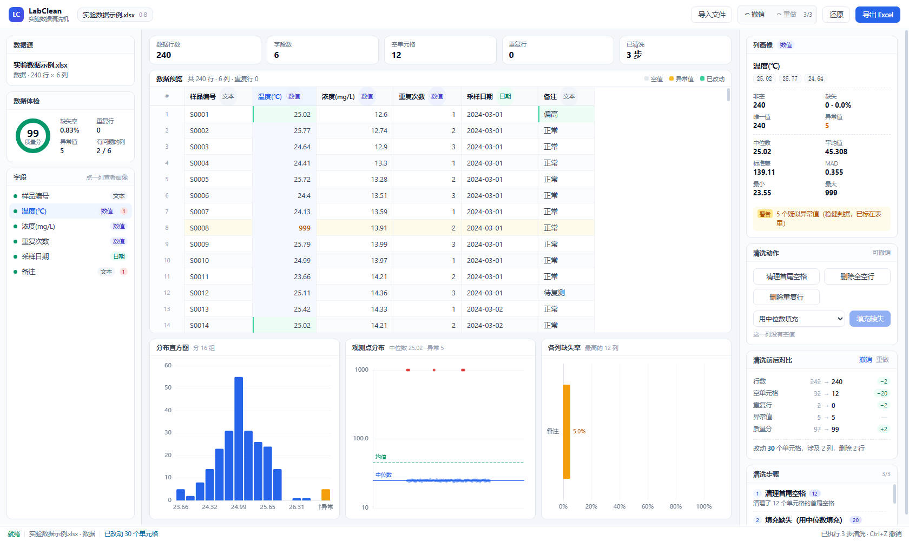

# LabClean 团队接手说明

> 这份文档写给**第一次接触这个项目的人**。看完你应该能：跑起来、看懂代码在哪、自己动手加功能、避开我们已经踩过的坑。

---

## 1. 这是什么

**LabClean 是一个纯本地运行的实验数据清洗与可视化工具。**

把 Excel / CSV 拖进浏览器（或桌面版窗口），它会：

1. 自动体检（类型识别、缺失、重复、异常值、质量分）
2. 让你一步步清洗（每步都能撤销）
3. 把清洗前后的差异摆出来给你看
4. 导出成一份可以直接交给别人的 Excel 报告

**核心卖点：数据处理默认在本机完成。** 没有后端、没有上传、断网可用。AI 诊断是默认关闭的可选项，只有用户明确启用并点击诊断时才联网，而且只发送表头与统计摘要，不发送数据行。

技术形态：**一套前端代码，两种交付**。网页版（浏览器打开）+ 桌面版（Tauri 打包的 3.6 MB 免安装 exe），功能完全一致。



---

## 2. 现在能做什么

| 能力 | 具体内容 |
|---|---|
| 导入 | `.xlsx / .xls / .csv / .tsv`；多个文件一起拖；一个文件的**每个工作表**都会成为独立数据源；编码自动识别（UTF-8 / BOM / GB18030） |
| 体检 | 列类型推断、缺失率、唯一值、重复行、**稳健异常值**（中位数+MAD）、0–100 质量分、逐列问题清单 |
| 表格 | 虚拟滚动（百万行只渲染可见的几十行）、空值/异常值/已改动单元格高亮 |
| 图表 | 分布直方图（异常值单独成柱）、观测点散点+参考线（跨数量级自动对数轴）、各列缺失率 |
| AI 诊断 | 默认关闭、首次知情确认；只发送表头与统计摘要，返回只读建议和实验报告文字 |
| 清洗 | 清理空格、删空行、删重复行、缺失填充（5 种策略）、文本转数字、**模糊去重**（编辑距离 + 可选拼音） |
| 撤销 | 全部动作可撤销/重做（`Ctrl+Z` / `Ctrl+Shift+Z`），靠"从原始数据重放"实现 |
| 对比 | 清洗前后指标对照；多个数据源之间横向对比（质量卡片 + 分组条形图） |
| 模板 | 把一套清洗步骤存下来，**按列名**套用到别的表，可一键应用到全部数据源 |
| 导出 | 单表：4 个 sheet（数据/体检报告/摘要/日志）；多源：对比总表 + 每个源一张数据表 |

**回归测试**：315 项核心逻辑断言全通过。

---

## 3. 怎么跑起来

### 第一次准备

```bash
cd xiangmu
npm install          # 装依赖（约 1 分钟）
```

> 如果 npm 报权限错，加 `--cache .\.npm-cache` 把缓存指到项目内。

### 日常开发（最常用）

```bash
npm run dev          # 打开 http://127.0.0.1:5173
```

改代码会自动热更新。这是**平时改功能的唯一命令**。

### 看构建后的效果

```bash
npm run build        # 产物在 dist/
npm run serve        # 零依赖静态服务器，预览 dist
```

### 打包桌面版 exe

```bash
npm run exe          # 产物：src-tauri/target/release/labclean.exe
```

或者双击项目根目录的 **`一键打包exe.bat`**。

> 需要 Rust 工具链（已装在项目内 `.rust/`）和 Visual Studio C++ 生成工具。脚本会自动处理环境变量，不用手动配。

### 自带演示数据

下面三个地址打开就能看效果，不用准备任何文件：

- `?demo=1` —— 3 个质量不同的示例数据源
- `?demo=1&auto=1` —— 自动给第一个源跑三步清洗
- `?demo=1&view=compare` —— 直接进入数据对比视图

---

## 4. 代码地图

**按"我想改什么"来找：**

| 我想改… | 去哪 |
|---|---|
| 界面的样子 | `src/styles.css` + `src/components/*.tsx` |
| 添加一个清洗动作 | `src/core/clean.ts` + `src/core/pipeline.ts`（见第 5 节） |
| 加一张图表 | `src/components/ChartsDock.tsx` + `src/lib/analyze.ts` |
| 改体检规则 / 质量分算法 | `src/core/profile.ts` |
| 改导出的 Excel 结构 | `src/core/report.ts` |
| 改 Excel 读写 | `src/core/xlsx-io.ts` |
| 改导入流程 | `src/App.tsx` 的 `importFiles` + `src/workers/table.worker.ts` |
| 改模板 | `src/core/template.ts` + `src/components/TemplateDialog.tsx` |
| 改模糊去重算法 | `src/core/fuzzy.ts` + `src/components/FuzzyDialog.tsx` |
| 改桌面版窗口 | `src-tauri/tauri.conf.json` + `src-tauri/src/main.rs` |

### 目录结构

```
src/
  core/            纯逻辑，不碰 DOM，可以被 node 直接测试 ← 改这里最安全
    types.ts       数据结构定义
    value.ts       单元格识别（前导零、千分位、日期、长整数）
    csv.ts         CSV 解析器
    encoding.ts    编码判定
    xlsx-io.ts     Excel 读写
    profile.ts     ★ 体检核心：类型、缺失、唯一、异常、重复、质量分
    clean.ts       ★ 清洗算子（写时复制）
    pipeline.ts    ★ 步骤描述 + 重放（撤销的原理）
    compare.ts     多数据源指标汇总
    template.ts    清洗模板
    fuzzy.ts       模糊去重
    report.ts      导出工作簿
    demo.ts        内置示例数据
  workers/
    table.worker.ts  解析与体检跑在 Worker 里，避免界面卡死
  lib/
    tableClient.ts   Worker 请求封装
    analyze.ts       画图用的一次遍历
    diff.ts          前后对比
    format.ts        数字格式化
  components/    界面组件（React）
  App.tsx        状态与流程编排
src-tauri/       桌面壳（Rust）
scripts/         测试、预览服务器、打包脚本
```

### 三个最重要的设计（不理解这个会改错代码）

**① 原始数据永不修改。**
解析出来的 `baseline` 是只读的。所有清洗算子都是**写时复制**——只有真正改动的那一行才复制一份新数组，其余行共用。所以撤销不需要存快照，只要"从 baseline 少重放一步"。

**② 清洗 = 一串可序列化的步骤。**
每一步是 `OpSpec`（纯数据，不含函数），所以能重放、能撤销、能存成模板、能存进 JSON。

**③ 解析和体检在 Worker 里。**
主线程只管渲染。大文件不会把界面卡成白屏。

---

## 5. 怎么加功能（照抄就能用）

### 配方 A：加一个清洗动作（比如"删除某列"）

**第 1 步** `src/core/clean.ts` —— 写算子，记住**不能改入参**：

```ts
export function opDropColumn(rows: CellValue[][], colIndex: number): OpResult {
  const next = rows.map((row) => {
    const copy = row.slice()
    copy.splice(colIndex, 1)   // 复制一份再改
    return copy
  })
  return { rows: next, affected: rows.length, detail: `删除了第 ${colIndex + 1} 列` }
}
```

**第 2 步** `src/core/pipeline.ts` —— 三处都要加：

```ts
// 1) OpSpec 联合类型加一项
| { kind: 'dropColumn'; colIndex: number; colName: string }

// 2) opTitle 加一个 case
case 'dropColumn': return `删除列（${spec.colName}）`

// 3) applySpec 的 switch 加一个分支
case 'dropColumn': {
  const r = opDropColumn(rows, spec.colIndex)
  return { rows: r.rows, origins, affected: r.affected, detail: r.detail }
}
```

**第 3 步** `src/components/Inspector.tsx` —— 加个按钮：

```tsx
<button className="btn btn-ghost" disabled={busy}
  onClick={() => onRun({ kind: 'dropColumn', colIndex: column.index, colName: column.name })}>
  删除这一列
</button>
```

**第 4 步** `scripts/smoke.ts` —— 加断言，跑 `npm run smoke` 确认没改坏。

> 如果希望它也能进模板，还要改 `src/core/template.ts` 的三个函数。

### 配方 B：加一张图

`src/components/ChartsDock.tsx` 里已经有 3 张卡片的写法，复制一个：

```tsx
const myOption = useMemo<EChartsOption>(() => {
  if (!col?.numeric) return {}
  return {
    grid: { left: 44, right: 14, top: 14, bottom: 28 },
    xAxis: { type: 'category', data: [...], ...AXIS },
    yAxis: { type: 'value', ...AXIS },
    series: [{ type: 'bar', data: [...], itemStyle: { color: '#2563eb' } }],
  }
}, [col, analysis])

// 然后在 return 里加一张卡
<Card title="我的新图" sub="说明"><Chart option={myOption} /></Card>
```

需要新的统计数据，就在 `src/lib/analyze.ts` 的 `analyzeColumn` 里一次遍历算出来（别每次渲染都扫全表）。

### 配方 C：加一条体检规则

`src/core/profile.ts`：

1. 在 `types.ts` 的 `IssueCode` 里加一个枚举值
2. 在 `buildIssues()` 里判断并 push
3. 需要影响质量分就在 `scoreColumn()` 里扣分

### 配方 D：改界面

界面是 React + 手写 CSS，没有组件库。设计变量在 `src/styles.css` 开头的 `:root` 里（`--accent` / `--line` / `--muted` 等），改配色只改那里。

---

## 6. 必须知道的六个坑

这些是我们真实踩过的，不要再踩一遍：

### ① 桌面版 exe 启动即崩溃 / 白屏

**现象**：双击没反应，或者窗口一闪就没。日志里 `Failed to setup app: 拒绝访问 (os error 5)`。

**原因**：项目目录带「低完整性级别」标记，编译出的 exe 继承了这个标记，运行时是**低权限进程**，写不了 WebView2 的数据目录。

**已经处理**：`scripts/build-exe.mjs` 会在打包后自动执行 `icacls <exe> /setintegritylevel Medium`。

**如果又出现**：手动执行一次同样命令即可。或者把 exe 复制到项目外（比如桌面）再运行 —— 那里没有这个标记。

### ② 16 位以上的整数

身份证号、订单号、19 位编号，读成数字会被**悄悄改掉末位**（JS 只有 2^53 安全整数）。代码里已经处理：超过 16 位一律按文本读。**新写解析逻辑时不要破坏这个规则。**

### ③ 不要就地修改 baseline

所有算子必须返回新的行数组。图省事写 `row[c] = x` 会污染原始数据，撤销会失效。正确写法见 `src/core/clean.ts`。

### ④ 模板按列名，不按列下标

换一张表列顺序就变了。模板里存的必须是列名，套用时找不到就跳过。

### ⑤ 大文件的性能红线

现在所有数据都在内存里（行数组）。**50 万行以内很流畅**（5000 行解析+体检约 150 ms）。再往上要考虑接 DuckDB-WASM 换掉数据层 —— 这是个重构量比较大的任务。

### ⑥ 受限环境下的 npm / 构建

如果 `npm install` 报 `EPERM`，把缓存放项目内：`npm install --cache .\.npm-cache`。
如果 `vite build` 报 esbuild 删除临时文件失败，把 `TEMP` 指到项目内（`scripts/build-exe.mjs` 里已有这个处理）。

---

## 7. 测试

```bash
npm run smoke        # 315 项断言，不需要浏览器
```

它会用 esbuild 把 `scripts/smoke.ts` 打包成单文件，再用 node 跑断言。覆盖：CSV 解析、类型识别、体检、异常值判定、长数字精度、Excel 往返、Worker 链路、撤销重放、模板套用、模糊去重、多源指标。

### 加断言的写法

```ts
console.log('\n[14] 你新增的功能')
{
  const ds = buildDataset('t.csv', '数据', parseCsv('a,b\n1,2\n'))
  eq('行数', ds.meta.rowCount, 1)
  check('某个条件成立', ds.columns[0].type === 'number')
}
```

`eq(名字, 实际, 期望)` / `check(名字, 条件, 失败时显示的详情)`。跑完会打印通过/失败数量，有失败会以非零码退出。

**改完核心逻辑一定要跑一遍**，比手动点界面可靠得多。

---

## 8. 下一步可以做什么

按"性价比"排的，都标了难度：

| 任务 | 难度 | 说明 |
|---|---|---|
| **答辩材料** | ★☆ | 架构图、演示脚本、技术报告。功能已经够了，这块直接决定得分 |
| **模板 JSON 导入导出** | ★☆ | 步骤已是可序列化的 `OpSpec`，加两个按钮读写 JSON 即可，方便团队之间传规则 |
| **PII 脱敏** | ★★ | 手机号/身份证/邮箱/银行卡正则识别 + 一键掩码。答辩很好讲（隐私合规） |
| **值归一化** | ★★ | 把「张三 / 张 三 / 张叁」合并成同一个写法（而不是删行）。比模糊去重更安全，场景也更常见 |
| **导出附前后对比 sheet** | ★☆ | `report.ts` 里加一张表即可 |
| **DuckDB-WASM 大数据** | ★★★ | 换数据层，支持百万行。要重构 `profile.ts` / `pipeline.ts`，风险较高 |
| **Tauri 原生文件对话框** | ★★ | 支持"选一个文件夹批量导入"，用 `@tauri-apps/plugin-dialog` |

### 建议的推进顺序

1. **先做答辩材料** —— 代码已经完整，剩下的时间应该花在"讲清楚"上
2. 再挑 1–2 个 ★☆ 或 ★★ 的功能补充，让功能表更好看
3. ★★★ 的除非时间充裕，否则别动

---

## 9. 答辩 / 交付清单

### 演示前必须做的

- [ ] 在**演示用的那台机器**上跑一次 exe（把整个 `release` 文件夹拷过去）
- [ ] 准备好网页版后备方案：`npm run serve` → 浏览器打开 127.0.0.1:5173
- [ ] 准备 `samples/实验数据示例.xlsx`（5002 行）作为现场导入的真实文件
- [ ] 记住三个演示 URL（`?demo=1`、`?auto=1`、`?view=compare`）

### 5 分钟演示脚本

| 时间 | 做什么 | 说什么 |
|---|---|---|
| 0:00 | 拖入 5002 行的示例文件 | "数据不出本机，全程本地处理" |
| 0:30 | 指向左侧质量分和问题清单 | "自动识别出 20 个缺失、2 行重复、5 个异常值" |
| 1:00 | 切到温度列，看直方图和散点 | "异常值单独成柱，不压扁坐标轴；判据用中位数+MAD，不会被极端值带偏" |
| 1:30 | 点"填充缺失"→ 撤销 → 重做 | "每一步都能撤销，因为是从原始数据重放" |
| 2:00 | 看右栏"清洗前后对比" | "行数 242→240，空值 32→12，质量分 97→99" |
| 2:30 | 导入第二个文件，切到对比视图 | "多组实验数据横向比质量" |
| 3:30 | 存模板 → 套用到另一个数据源 | "一套规则复用，按列名匹配，列对不上会跳过" |
| 4:00 | 导出 Excel，打开看 4 个 sheet | "数据、体检报告、摘要、操作日志，拿去做实验记录" |
| 4:30 | 断网演示（可选） | "现在我把网断了，功能完全不受影响" |

### 技术亮点（用来回答提问）

1. **数据零出网**是架构决定的，不是承诺 —— 没有后端
2. **稳健统计**：中位数 + MAD，阈值 3.5（Iglewicz & Hoaglin 推荐值）
3. **写时复制 + 重放**：撤销不存快照，内存只跟"改了多少"成正比
4. **长整数保护**：2^53 精度陷阱
5. **WebView2 低完整性级别**那个排查案例（见第 6 节①）—— 这是最能体现工程能力的部分

---

## 10. 协作约定

- **分支**：直接在 `main` 上小步提交也行，多人并行时建议 `feat/xxx` 分支
- **提交信息**：`feat: xxx` / `fix: xxx` / `chore: xxx`，正文写清楚改了什么
- **不要提交**：`node_modules/`、`dist/`、`.rust/`、`release/`、`.npm-cache/`（都已在 `.gitignore`）
- **改核心逻辑前**：先跑一遍 `npm run smoke` 拿到基线，改完再跑
- **不确定就问**：`README.md` 有更详细的技术决策说明

---

*最后更新：桌面版打包链路修复之后*
